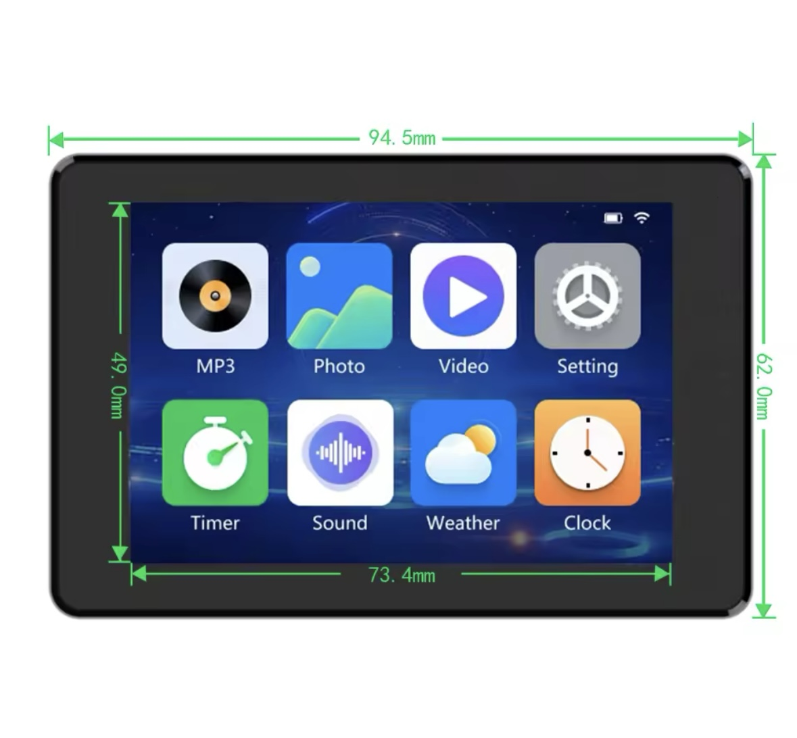
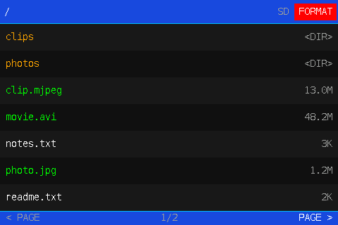
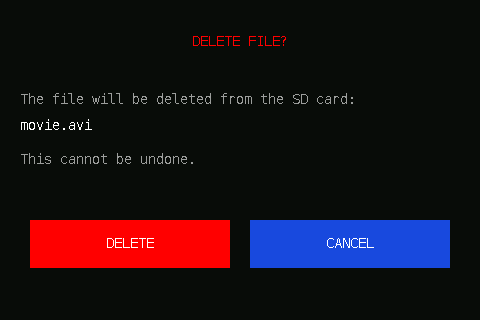
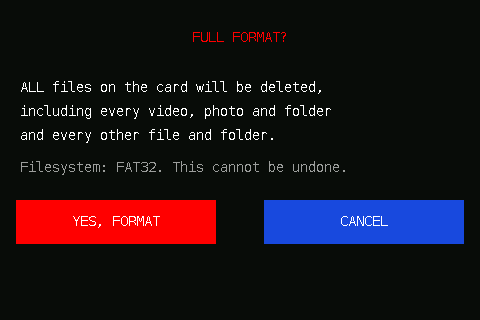
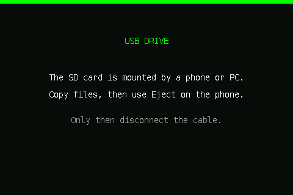
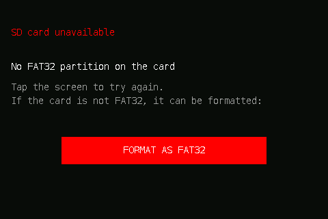

# 🖥️ JC3248W535 ESPHome Media Player


[](https://github.com/yeswolf/jc3248w535-esphome/releases/latest)

<p align="center">
  
</p>

**A 3.5-inch Guition ESP32-S3 screen that plays MJPEG from microSD, mounts the card as a
USB drive and takes orders from Home Assistant.** No cloud, no phone app, no subscription.

ESPHome firmware for the **JC3248W535 / JC3248W535C / JC3248W535EN** — the
**AXS15231B 320x480 IPS** panel with an **ESP32-S3-WROOM-1 N16R8**. The repo also carries
the full board archive: schematics, pinout, datasheets and factory firmware.

**Firmware:** [v1.0.19](https://github.com/yeswolf/jc3248w535-esphome/releases/latest) ·
**Docs:** [docs/](docs/README.md) ·
**Source:** [github.com/yeswolf/jc3248w535-esphome](https://github.com/yeswolf/jc3248w535-esphome)

## ✨ What it does

- 🎞️ **MJPEG / AVI player** — raw `.mjpeg` and MJPG AVI, full screen and looping.
- 🖼️ **Slideshow** — every photo and video on the card, in order, forever.
- 🗂️ **Touch file browser** — folders, pages and long-press delete. Cyrillic names welcome.
- 💾 **USB mass storage** — plug in USB-C and the card shows up as a drive.
- 🏠 **Home Assistant** — file picker, media player, transport, sleep, brightness, colour
  and diagnostics.
- 📤 **Upload + OTA** — drop files over HTTP or update the firmware over the air.

## 📸 Screens

Rendered from the firmware's own layout and bitmap font at 480x320 — not photos of the
panel.

<p align="center">
  
</p>

| Delete confirmation | Format confirmation |
|---|---|
|  |  |
| **USB drive mode** | **Card error** |
|  |  |

## ⚡ Install

**Fast path** — grab `jc3248w535-esphome-v1.0.19.factory.bin` from
[Releases](https://github.com/yeswolf/jc3248w535-esphome/releases/latest), put the board
in download mode (hold **BOOT**, tap **RST**, release **BOOT**), replug USB-C, then:

```sh
esptool.py --chip esp32s3 -p /dev/ttyACM0 -b 460800 \
  write_flash 0x0 jc3248w535-esphome-v1.0.19.factory.bin
```

After that, update over the air with the `.ota.bin` asset or `esphome run`.

**From source** — ESPHome 2026.10.0+, then copy
[`esphome/secrets.example.yaml`](esphome/secrets.example.yaml) to `secrets.yaml`, fill in
Wi-Fi, API key and upload login, and build:

```sh
cd esphome
cp secrets.example.yaml secrets.yaml
esphome compile jc3248w535.yaml
```

Build, OTA, entities and upload API: [`esphome/README.md`](esphome/README.md).

## 🧰 Hardware

|  |  |
|---|---|
| 🧠 MCU | **ESP32-S3-WROOM-1 N16R8** — 16 MB flash, 8 MB PSRAM |
| 🖥️ Display | 3.5" **320x480 IPS**, **AXS15231B** over QSPI |
| 👆 Touch | in-cell capacitive, I2C `0x3B` |
| 💾 Storage | microSD over SDMMC, 1-bit |
| 🔌 USB | native ESP32-S3 OTG, USB-C |
| 🔊 Audio | NS4168 mono class-D — present but parked, no playback |
| 🔋 Power | USB-C + Li-ion charger + 5 V boost |

Full pin map, audio path and power notes: [`docs/board/README.md`](docs/board/README.md).

## 📚 Documentation

| Guide | What's inside |
|---|---|
| [`docs/usage.md`](docs/usage.md) | On-device UI, media preparation, dashboard cards, limitations |
| [`docs/README.md`](docs/README.md) | Archive index, provenance and the complete vendor package |
| [`docs/board/README.md`](docs/board/README.md) | Ports, pin map, schematics, audio and power |
| [`docs/datasheets/README.md`](docs/datasheets/README.md) | NS4168, AX98357A, ESP32-S3 and ESP32-S3-WROOM-1 |
| [`docs/factory-firmware/README.md`](docs/factory-firmware/README.md) | Factory restore images, checksums, burn instructions, stock fonts |
| [`esphome/README.md`](esphome/README.md) | Entities, build, flashing, HTTP upload and OTA |

## 🕹️ Dashboard cards

Two ready-to-paste Home Assistant cards, both with generic entity IDs:

- [`esphome/dashboard_card.yaml`](esphome/dashboard_card.yaml) — full card: file selection,
  delete, player, transport, slideshow, diagnostics and the log iframe.
- [`esphome/dashboard_card_mini.yaml`](esphome/dashboard_card_mini.yaml) — compact card:
  player, file selection, sleep, brightness and transport.

Paste as a **Manual card**; details in [`docs/usage.md`](docs/usage.md#dashboard-cards).

## ⚠️ Known limitations

- AVI must be MJPEG (`MJPG`); frames must be exactly 480x320.
- Raw MJPEG has no timing and runs at up to 30 fps; AVI follows its stream header.
- No audio playback — the amplifier is intentionally silent.
- ESPHome sleep is not deep sleep: the backlight and playback stop, Wi-Fi and the API stay
  up.

The full list lives in [`docs/usage.md`](docs/usage.md#known-limitations).

## 🙏 Credits

- AXS15231B panel and touch driver:
  [`GlomarGadaffi/jc3248-display-driver`](https://github.com/GlomarGadaffi/jc3248-display-driver)
  (Apache-2.0), tuned for this panel.
- [`espressif/esp_lcd_touch`](https://components.espressif.com/components/espressif/esp_lcd_touch)
  and [`espressif/esp_new_jpeg`](https://components.espressif.com/components/espressif/esp_new_jpeg).
- Font: DejaVu Sans Mono, baked by [`tools/make_font.py`](tools/make_font.py).
- Vendor docs and factory images: see [`docs/README.md`](docs/README.md#provenance).

## 📄 License

No `LICENSE` file yet — usage conditions for the project's own code are not defined.
Vendor documents and factory images in `docs/` stay with their respective owners.

⭐ If this saved you a weekend, a star helps other people find the board.
