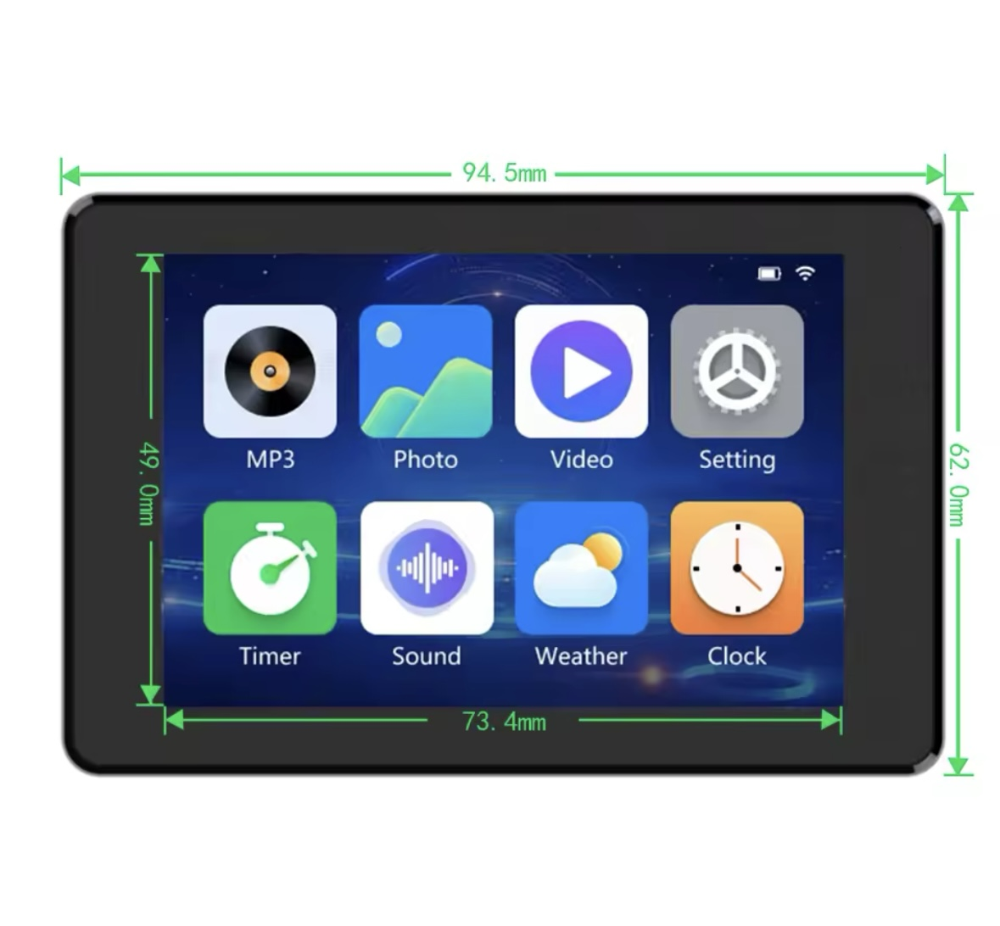
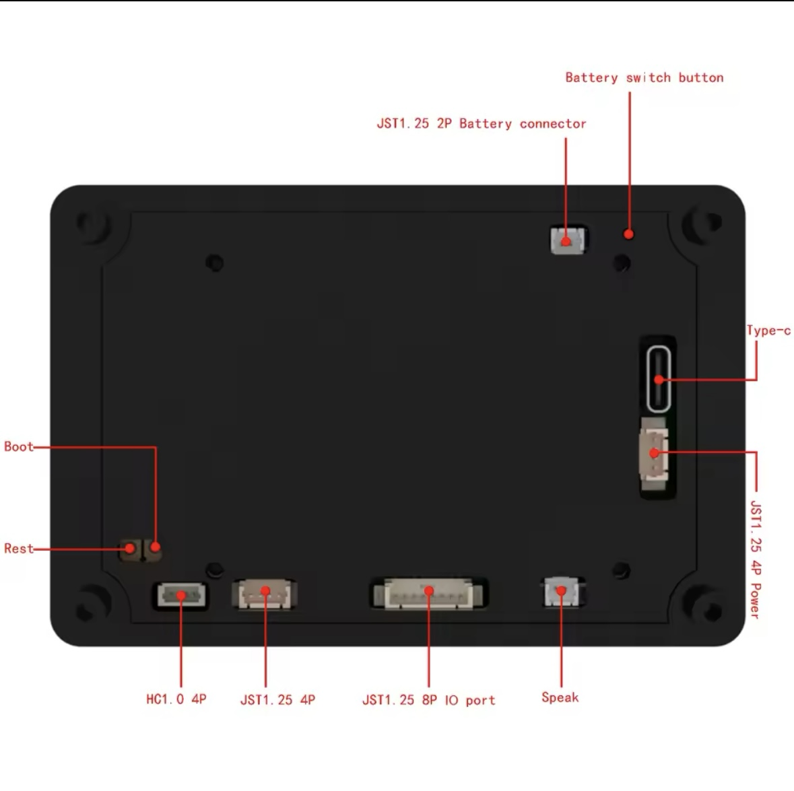

# Board documentation

The Guition **JC3248W535** is a 3.5-inch ESP32-S3 display module. The capacitive
variant used by this project is sold as **JC3248W535C** / **JC3248W535EN**; the vendor
package identifies it as `JC3248W535C_I_Y`.



| Item | Value |
|---|---|
| Module size | 94.5 x 62.0 mm |
| Active area | 73.4 x 49.0 mm |
| Display | 3.5" IPS TFT, 320x480, RGB565 |
| Display controller | AXS15231B, QSPI |
| Touch | In-cell capacitive, AXS15231B, I2C address `0x3B` |
| MCU | ESP32-S3-WROOM-1, 16 MB flash, 8 MB octal PSRAM |
| Storage | microSD on SDMMC, 1-bit |
| USB | Native ESP32-S3 USB OTG, USB-C |
| Audio | NS4168 I2S DAC + mono class-D amplifier, 2-pin speaker connector |
| Power | USB-C, JST1.25 2P battery, on-board Li-ion charger and 5 V boost |
| Exposed IO | Up to 12 GPIO on JST connectors |

## Ports



| Port | Type | Use |
|---|---|---|
| USB-C | USB 2.0 OTG | Power, flashing, USB mass storage |
| JST1.25 2P | Battery | Li-ion cell |
| Battery switch | Slide switch | Connects or disconnects the battery |
| JST1.25 4P | Power | 5 V input/output |
| JST1.25 8P | IO | IO5, IO6, IO7, IO15, IO16, IO46, IO9, IO14 |
| Speak | JST1.25 2P | Loudspeaker, driven by the NS4168 |
| Boot | Button | Download mode |
| Reset | Button | Reset |

## Pin map

| Block | Signal | GPIO |
|---|---|---|
| Display (QSPI) | CS | 45 |
| Display (QSPI) | SCLK | 47 |
| Display (QSPI) | D0 | 21 |
| Display (QSPI) | D1 | 48 |
| Display (QSPI) | D2 | 40 |
| Display (QSPI) | D3 | 39 |
| Display | Backlight | 1 |
| Touch (I2C) | SDA | 4 |
| Touch (I2C) | SCL | 8 |
| Touch | INT | 3 (not used by this firmware) |
| microSD (SDMMC) | CLK | 12 |
| microSD (SDMMC) | CMD | 11 |
| microSD (SDMMC) | D0 | 13 |
| USB OTG | D- | 19 |
| USB OTG | D+ | 20 |
| Audio (I2S) | LRCLK | 2 |
| Audio (I2S) | BCLK | 42 |
| Audio (I2S) | DATA | 41 |
| Audio | Amplifier CTRL | pulled up to VOUT-BAT through 1 MOhm |

See [`pinout/GPIO_pinout.jpg`](pinout/GPIO_pinout.jpg) for the vendor table and
[`pinout/JC3248W535-IO-1.png`](pinout/JC3248W535-IO-1.png) /
[`pinout/JC3248W535-IO-2.png`](pinout/JC3248W535-IO-2.png) for the connector
distribution.

## Audio path

The board does not have a codec with a headphone amplifier and does not have a 3.5 mm
jack. The only audio output is the 2-pin **Speak** connector.

```
ESP32-S3 I2S ── LRCLK(2) / BCLK(42) / DATA(41) ── U4 NS4168 ── L4/L5 ── JST1.25 2P "Speak"
```

The **NS4168** (U4) integrates a DAC and a mono class-D power stage. The amplifier is
powered from the 5 V rail produced by the power-management IC (U2), and its outputs go
through two inductors straight to the speaker connector. There is no enable or shutdown
pin, and no register interface: the only control is the `CTRL` pin (channel selection
and input high-pass corner) and the digital sample level.

Key NS4168 figures from the [datasheet](../datasheets/NS4168.pdf):

| Parameter | Value |
|---|---|
| Output power | 2.5 W into 4 Ohm at 5 V |
| THD+N | 0.2% at 1 W, 4 Ohm, 5 V |
| Signal-to-noise ratio | 85 dB |
| Sample rates | 8 kHz to 96 kHz, auto-detected |
| Channels | Mono |
| Output stage | Filterless class D |

The output is differential (bridge-tied). Do not connect headphones directly to the
Speak connector: both pins carry the switching output, there is no ground reference,
and the filterless output has a high-frequency carrier and a DC bias.

## Display notes

- The panel is native portrait 320x480. This firmware drives it in that orientation and
  rotates the landscape 480x320 UI in software.
- QSPI runs at 40 MHz, the stable ceiling for this panel.
- The panel init table does not issue `DISPON`; the firmware calls
  `esp_lcd_panel_disp_on_off()` after init.
- Frames are sent as full-width stripes; the first stripe opens with `RAMWR`, the rest
  continue with `RAMWRC`.

## Power

U2 is a power-bank controller with a Li-ion charger and a 5 V boost. It feeds the
display, the ESP32-S3 and the NS4168. A slide switch connects the battery. With USB-C
connected the board runs from USB and charges the cell; without USB it runs from the
battery through the boost.

## Mechanical drawings

- [`mechanical/slot-method-1.dxf`](mechanical/slot-method-1.dxf)
- [`mechanical/slot-method-2.dxf`](mechanical/slot-method-2.dxf)

## Full documents

- [Specification (PDF)](specifications/JC3248W535-Specifications-EN.pdf)
- [Getting started (PDF)](specifications/Getting-started-JC3248W535.pdf)
- [Schematic, sheet 1](schematics/ESP32_schematic.jpg)
- [Schematic, power section](schematics/Power_schematic.jpg)
- [Arduino IDE setup](pinout/Arduino-IDE-setup.jpg)
